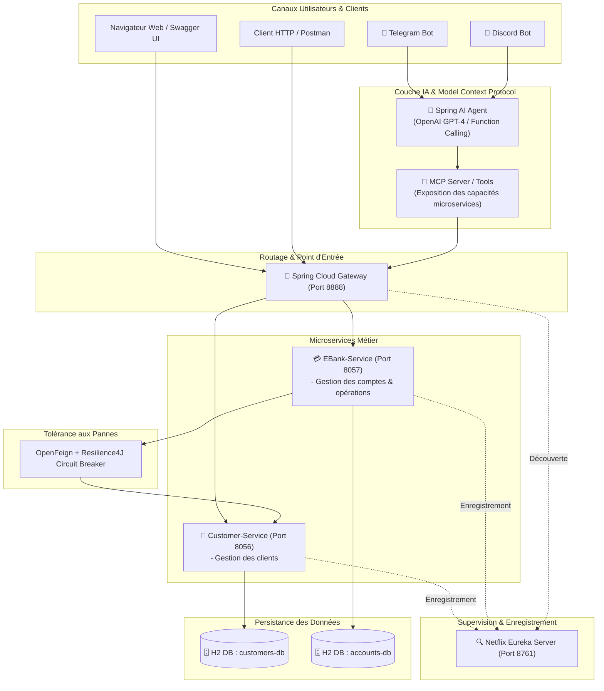
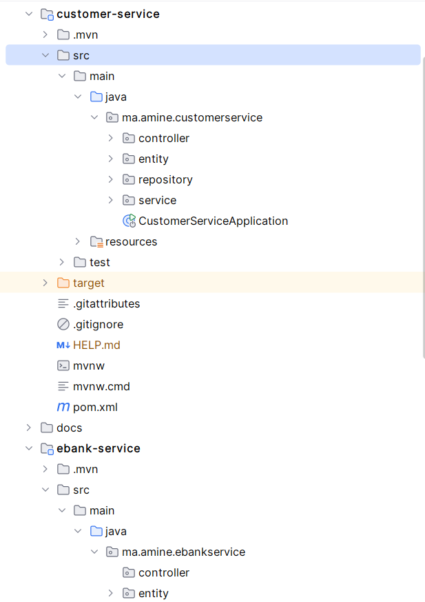
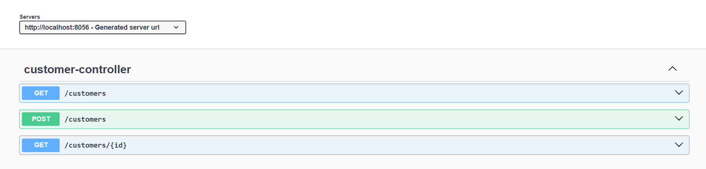
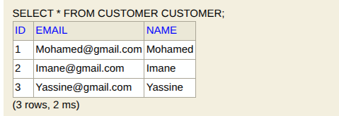
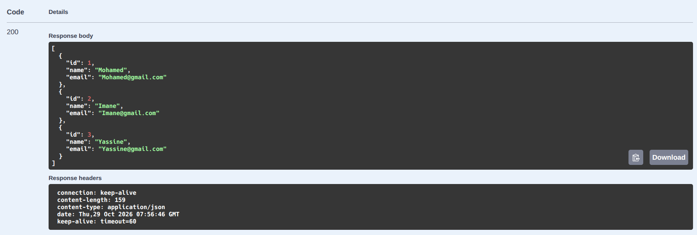
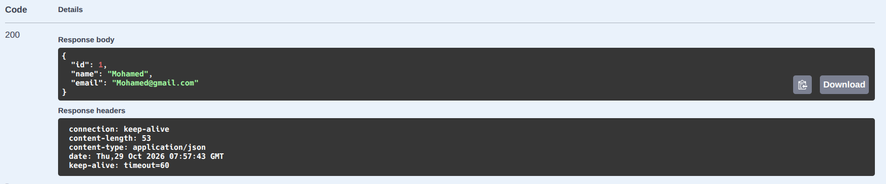
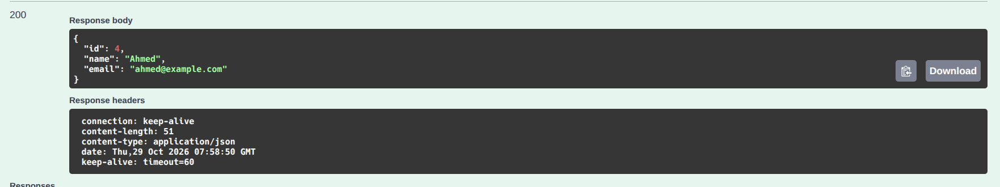

# Architecture Microservices Bancaire (E-Bank) & Intelligence Artificielle Agentique (Spring AI & MCP)

[](https://openjdk.org/)
[](https://spring.io/projects/spring-boot)
[](https://spring.io/projects/spring-cloud)
[](https://springdoc.org/)
[](https://www.h2database.com/)
[](LICENSE)

> **Projet : Systèmes Distribués**
> **Encadré par :** Pr. Mohamed YOUSSFI
> **Auteur :** Amine Edarkaoui \
> **Statut :** En cours de réalisation (Étapes 1 à 3 validées)

---

## Table des Matières

- [Architecture Microservices Bancaire (E-Bank) \& Intelligence Artificielle Agentique (Spring AI \& MCP)](#-architecture-microservices-bancaire-e-bank--intelligence-artificielle-agentique-spring-ai--mcp)
  - [Table des Matières](#-table-des-matières)
  - [1. Présentation du Projet](#1-présentation-du-projet)
    - [Objectifs Majeurs du Projet :](#objectifs-majeurs-du-projet-)
  - [2. Architecture Globale du Système](#2-architecture-globale-du-système)
    - [2.1 Vue Cible du Système Distribué \& IA](#21-vue-cible-du-système-distribué--ia)
    - [2.2 Périmètre Actuellement Implémenté](#22-périmètre-actuellement-implémenté)
  - [3. Réalisations \& Modules Développés](#3-réalisations--modules-développés)
    - [Étape 1 : Projet Racine Multi-Modules (`ebank-microservice-app`)](#étape-1--projet-racine-multi-modules-ebank-microservice-app)
    - [Étape 2 : Microservice `customer-service` (Port : 8056)](#étape-2--microservice-customer-service-port--8056)
      - [1. Dépendances Clés (`pom.xml`)](#1-dépendances-clés-pomxml)
      - [2. Architecture Interne des Classes (`ma.amine.customerservice`)](#2-architecture-interne-des-classes-maaminecustomerservice)
      - [3. Configuration Applicative (`customer-service/src/main/resources/application.properties`)](#3-configuration-applicative-customer-servicesrcmainresourcesapplicationproperties)
    - [Étape 3 : Microservice `ebank-service` (Base - Port : 8057)](#étape-3--microservice-ebank-service-base---port--8057)
      - [1. Dépendances Clés (`pom.xml`)](#1-dépendances-clés-pomxml-1)
      - [2. Architecture Interne des Classes (`ma.amine.ebankservice`)](#2-architecture-interne-des-classes-maamineebankservice)
      - [3. Configuration Applicative (`ebank-service/src/main/resources/application.properties`)](#3-configuration-applicative-ebank-servicesrcmainresourcesapplicationproperties)
  - [4. Spécification \& Documentation des Endpoints REST](#4-spécification--documentation-des-endpoints-rest)
    - [Endpoints exposés par `customer-service` (Port 8056)](#endpoints-exposés-par-customer-service-port-8056)
      - [Exemple de Requête \& Réponse : Création d'un client (`POST /customers`)](#exemple-de-requête--réponse--création-dun-client-post-customers)
      - [Exemple de Réponse : Liste des clients (`GET /customers`)](#exemple-de-réponse--liste-des-clients-get-customers)
  - [5. Guide d'Installation et de Démarrage](#5-guide-dinstallation-et-de-démarrage)
    - [5.1 Prérequis](#51-prérequis)
    - [5.2 Clonage et Compilation](#52-clonage-et-compilation)
    - [5.3 Lancement des Microservices](#53-lancement-des-microservices)
      - [Terminal 1 : Démarrer `customer-service`](#terminal-1--démarrer-customer-service)
      - [Terminal 2 : Démarrer `ebank-service`](#terminal-2--démarrer-ebank-service)
    - [5.4 Consoles d'Administration \& Documentation](#54-consoles-dadministration--documentation)
  - [6. Galerie des Tests \& Captures d'Écran](#6-galerie-des-tests--captures-décran)
    - [6.1 Documentation Interactive Swagger UI (`customer-service`)](#61-documentation-interactive-swagger-ui-customer-service)
    - [6.2 Base de Données H2 \& Données Initialisées (`customer-service`)](#62-base-de-données-h2--données-initialisées-customer-service)
    - [6.3 Tests des Endpoints REST (`customer-service`)](#63-tests-des-endpoints-rest-customer-service)
    - [6.4 Test de Création d'un Nouveau Client (`POST /customers`)](#64-test-de-création-dun-nouveau-client-post-customers)
    - [6.5 Microservice `ebank-service` (Console H2 \& Swagger)](#65-microservice-ebank-service-console-h2--swagger)
  - [7. Feuille de Route \& Prochaines Étapes (Roadmap)](#7-feuille-de-route--prochaines-étapes-roadmap)
    - [Suite Partie 1 : Résilience, Découverte \& Routage](#suite-partie-1--résilience-découverte--routage)
    - [Partie 2 : Intelligence Artificielle Agentique \& Serveurs MCP](#partie-2--intelligence-artificielle-agentique--serveurs-mcp)
    - [Partie 3 : Déploiement Multi-Canal (REST, Telegram, Discord)](#partie-3--déploiement-multi-canal-rest-telegram-discord)
  - [8. Références \& Supports de Cours](#8-références--supports-de-cours)

---

## 1. Présentation du Projet

Ce projet a pour objectif de concevoir et réaliser une **architecture distribuée complète** pour une application bancaire moderne (**E-Bank**), combinant les standards de l'écosystème **Spring Cloud microservices** et les avancées récentes de l'**Intelligence Artificielle Agentique** avec **Spring AI** et le protocole standardisé **MCP (Model Context Protocol)**.

### Objectifs Majeurs du Projet :
1. **Architecture Microservices Réactive & Résiliente :** Découpage du domaine bancaire en services autonomes (`customer-service`, `ebank-service`), inter-connectés de manière déclarative avec **OpenFeign** et protégés contre les pannes en cascade grâce à **Resilience4J (Circuit Breaker)**.
2. **Infrastructure Cloud Native :** Découverte dynamique de services avec **Netflix Eureka Discovery Server** et point d'entrée sécurisé et unifié via **Spring Cloud Gateway**.
3. **Agent IA & Intégration MCP :** Transformation des microservices en serveurs d'outils (**MCP Servers**), permettant à un agent conversationnel basé sur **Spring AI** d'exécuter des requêtes en langage naturel (consultation de soldes, extraction d'informations clients, opérations).
4. **Diffusion Multi-Canal :** Déploiement de l'assistant IA bancaire sur plusieurs interfaces de communication : **API REST**, **Bot Telegram** et **Bot Discord**.

---

## 2. Architecture Globale du Système

### 2.1 Vue Cible du Système Distribué & IA



### 2.2 Périmètre Actuellement Implémenté

À ce stade du projet, les socles fondamentaux des microservices de données ont été mis en place et validés :
- 🟢 **Projet Parent Multi-modules** Maven configuré.
- 🟢 **Microservice `customer-service`** opérationnel (entités, repository, service métier, contrôleur REST, H2 Database et documentation Swagger UI).
- 🟢 **Microservice `ebank-service`** initialisé (modélisation de l'entité `BankAccount`, modèle DTO `Customer`, repository JPA avec recherche par client, console H2).

---

## 3. Réalisations & Modules Développés

### Étape 1 : Projet Racine Multi-Modules (`ebank-microservice-app`)

Le projet racine sert de conteneur d'orchestration pour l'ensemble des microservices et composants distribués.

- **Type :** Projet Maven Multi-modules
- **Version Java :** 21 (support 17+)
- **Framework :** Spring Boot 3.5.x
- **Rôle :** Centraliser la gestion des dépendances transverses, unifier la compilation et héberger les sous-modules.

```
ebank-microservice-app/
├── pom.xml                     # POM racine orchestrateur
├── customer-service/           # Microservice de gestion des clients
│   ├── pom.xml
│   └── src/main/...
└── ebank-service/              # Microservice bancaire (comptes & transactions)
    ├── pom.xml
    └── src/main/...
```


*Figure 1 : Arborescence et organisation multi-modules sous IntelliJ IDEA*

---

### Étape 2 : Microservice `customer-service` (Port : 8056)

Ce microservice gère le cycle de vie des clients de la banque (création, consultation unitaire, listing global).

#### 1. Dépendances Clés (`pom.xml`)
- `spring-boot-starter-webmvc` : Exposition des endpoints RESTful.
- `spring-boot-starter-data-jpa` : Persistance relationnelle via Hibernate.
- `com.h2database:h2` : Base de données relationnelle en mémoire pour le développement rapide.
- `org.projectlombok:lombok` : Génération automatique des constructeurs, getters, setters et patterns builder.
- `spring-cloud-starter-netflix-eureka-client` & `spring-cloud-starter-config` : Préparation pour la découverte et la configuration centralisée.
- `spring-boot-starter-actuator` : Métriques et indicateurs de santé applicatifs.
- `springdoc-openapi-starter-webmvc-ui` : Génération automatique de la documentation interactive OpenAPI / Swagger UI.

#### 2. Architecture Interne des Classes (`ma.amine.customerservice`)

```
ma.amine.customerservice/
├── CustomerServiceApplication.java   # Point d'entrée & CommandLineRunner d'amorçage
├── controller/
│   └── CustomerController.java       # Contrôleur REST (/customers)
├── entity/
│   └── Customer.java                 # Entité JPA persistante
├── repository/
│   └── CustomerRepository.java       # Interface Spring Data JPA
└── service/
    └── CustomerService.java          # Couche logique métier
```

- **Entité JPA (`Customer.java`) :**
  ```java
  @Entity
  @Data @Builder @NoArgsConstructor @AllArgsConstructor
  public class Customer {
      @Id
      @GeneratedValue(strategy = GenerationType.IDENTITY)
      private Long id;
      private String name;
      private String email;
  }
  ```

- **Repository (`CustomerRepository.java`) :**
  ```java
  public interface CustomerRepository extends JpaRepository<Customer, Long> {
  }
  ```

- **Initialisation des données de test (`CustomerServiceApplication.java`) :**
  Un `CommandLineRunner` insère au démarrage trois profils clients représentatifs :
  ```java
  @Bean
  CommandLineRunner commandLineRunner(CustomerService customerService) {
      return args -> {
          List<String> names = List.of("Mohamed", "Imane", "Yassine");
          names.forEach(name -> {
              customerService.saveCustomer(Customer.builder()
                      .name(name)
                      .email(name + "@gmail.com")
                      .build());
          });
      };
  }
  ```

#### 3. Configuration Applicative (`customer-service/src/main/resources/application.properties`)
```properties
spring.application.name=customer-service
server.port=8056
spring.datasource.url=jdbc:h2:mem:customers-db
spring.h2.console.enabled=true
spring.cloud.discovery.enabled=false
spring.cloud.config.enabled=false
```

> **Note :** Les propriétés `spring.cloud.discovery.enabled` et `spring.cloud.config.enabled` sont positionnées sur `false` à titre transitoire pour tester les microservices de manière autonome avant le démarrage d'Eureka et du Config Server.

---

### Étape 3 : Microservice `ebank-service` (Base - Port : 8057)

Ce microservice assure la gestion des comptes bancaires (`BankAccount`), leur solde, leur type ainsi que leur liaison avec les clients respectifs.

#### 1. Dépendances Clés (`pom.xml`)
En plus du socle commun (`Web`, `Data JPA`, `H2`, `Lombok`, `Actuator`, `OpenAPI`), `ebank-service` embarque :
- `spring-cloud-starter-openfeign` : Client HTTP déclaratif pour interroger `customer-service`.
- `spring-cloud-starter-circuitbreaker-resilience4j` : Disjoncteur de protection contre les temps de latence et coupures réseau.

#### 2. Architecture Interne des Classes (`ma.amine.ebankservice`)

```
ma.amine.ebankservice/
├── EbankServiceApplication.java      # Point d'entrée Spring Boot
├── entity/
│   └── BankAccount.java              # Entité JPA persistante du compte bancaire
├── model/
│   └── Customer.java                 # Modèle DTO non persistant pour la communication Feign
└── repository/
    └── BankAccountRepository.java    # Interface Spring Data JPA avec méthode personnalisée
```

- **Modèle DTO (`model/Customer.java`) :**
  Objet non persistant permettant de réceptionner les données transmises par `customer-service` sans lier les schémas de base de données :
  ```java
  @Data @NoArgsConstructor @AllArgsConstructor @Builder
  public class Customer {
      private Long id;
      private String name;
      private String email;
  }
  ```

- **Entité JPA (`entity/BankAccount.java`) :**
  Modélise un compte bancaire avec sa clé primaire alphanumérique (UUID / String), son solde, sa date de création, l'identifiant du client propriétaire et une référence transitoire vers le DTO `Customer` :
  ```java
  @Entity
  @Data @NoArgsConstructor @AllArgsConstructor @Builder
  public class BankAccount {
      @Id
      private String id;
      private Date createdAt;
      private double balance;
      private String type;
      private Long customerId;

      @Transient
      private Customer customer;
  }
  ```

- **Repository (`repository/BankAccountRepository.java`) :**
  Déclaration d'une méthode de requête dérivée pour filtrer les comptes rattachés à un client précis :
  ```java
  public interface BankAccountRepository extends JpaRepository<BankAccount, String> {
      List<BankAccount> findByCustomerId(Long customerId);
  }
  ```

#### 3. Configuration Applicative (`ebank-service/src/main/resources/application.properties`)
```properties
spring.application.name=ebank-service
server.port=8057
spring.datasource.url=jdbc:h2:mem:accounts-db
spring.h2.console.enabled=true
spring.cloud.discovery.enabled=false
spring.cloud.config.enabled=false
```

---

## 4. Spécification & Documentation des Endpoints REST

### Endpoints exposés par `customer-service` (Port 8056)

| Méthode | URL | Description | Paramètres / Body | Code HTTP de Succès |
| :--- | :--- | :--- | :--- | :--- |
| `GET` | `/customers` | Récupérer la liste complète des clients | Aucun | `200 OK` |
| `GET` | `/customers/{id}` | Récupérer un client par son identifiant unique | `id` (Path Variable, Long) | `200 OK` / `500 Error` |
| `POST` | `/customers` | Enregistrer un nouveau client dans la base | JSON Body (`Customer`) | `200 OK` |

#### Exemple de Requête & Réponse : Création d'un client (`POST /customers`)

**Requête :**
```bash
curl -X POST http://localhost:8056/customers \
  -H "Content-Type: application/json" \
  -d '{
    "name": "Kenza Bennani",
    "email": "kenza.bennani@gmail.com"
  }'
```

**Réponse :**
```json
{
  "id": 4,
  "name": "Kenza Bennani",
  "email": "kenza.bennani@gmail.com"
}
```

#### Exemple de Réponse : Liste des clients (`GET /customers`)
```json
[
  {
    "id": 1,
    "name": "Mohamed",
    "email": "Mohamed@gmail.com"
  },
  {
    "id": 2,
    "name": "Imane",
    "email": "Imane@gmail.com"
  },
  {
    "id": 3,
    "name": "Yassine",
    "email": "Yassine@gmail.com"
  }
]
```

---

## 5. Guide d'Installation et de Démarrage

### 5.1 Prérequis
- **Java Development Kit (JDK) :** Version 17 ou 21 installée (`java -version`).
- **Apache Maven :** Version 3.8+ (`mvn -version`) ou utilisation du wrapper `mvnw`.
- **Git :** Pour cloner le dépôt.
- **Navigateur Web ou Postman :** Pour tester les interfaces et APIs.

### 5.2 Clonage et Compilation
```bash
# Cloner le dépôt Git
git clone https://github.com/votre-compte/ebank-microservice-app.git

# Se positionner dans le répertoire du projet
cd ebank-microservice-app
```

### 5.3 Lancement des Microservices

Ouvrez deux terminaux distincts pour démarrer les deux services en parallèle :

#### Terminal 1 : Démarrer `customer-service`
```bash
cd customer-service
mvn spring-boot:run
```
*Le service démarre sur le port `8056`.*

#### Terminal 2 : Démarrer `ebank-service`
```bash
cd ebank-service
mvn spring-boot:run
```
*Le service démarre sur le port `8057`.*

### 5.4 Consoles d'Administration & Documentation

Une fois les services démarrés, les interfaces interactives suivantes sont immédiatement disponibles :

| Service | Interface | URL d'Accès | Identifiants H2 |
| :--- | :--- | :--- | :--- |
| **customer-service** | Swagger UI (OpenAPI) | [http://localhost:8056/swagger-ui.html](http://localhost:8056/swagger-ui.html) | - |
| **customer-service** | Console H2 Database | [http://localhost:8056/h2-console](http://localhost:8056/h2-console) | JDBC URL: `jdbc:h2:mem:customers-db`, User: `sa`, Password: *(vide)* |
| **customer-service** | Spring Boot Actuator | [http://localhost:8056/actuator/health](http://localhost:8056/actuator/health) | - |
| **ebank-service** | Swagger UI (OpenAPI) | [http://localhost:8057/swagger-ui.html](http://localhost:8057/swagger-ui.html) | - |
| **ebank-service** | Console H2 Database | [http://localhost:8057/h2-console](http://localhost:8057/h2-console) | JDBC URL: `jdbc:h2:mem:accounts-db`, User: `sa`, Password: *(vide)* |
| **ebank-service** | Spring Boot Actuator | [http://localhost:8057/actuator/health](http://localhost:8057/actuator/health) | - |

---

## 6. Galerie des Tests & Captures d'Écran

> 💡 **Note à destination de l'évaluateur / développeur :**
> Les visuels ci-dessous illustrent les résultats attendus et servent d'emplacements réservés (*placeholders*). Vous pouvez remplacer les fichiers png du dossier `docs/screenshots/` par vos propres captures d'écran (PNG ou JPG).

### 6.1 Documentation Interactive Swagger UI (`customer-service`)

*Figure 2 : Interface Swagger UI exposant les routes `/customers`, `/customers/{id}`*

### 6.2 Base de Données H2 & Données Initialisées (`customer-service`)

*Figure 3 : Visualisation de la table `CUSTOMER` dans la console H2 (`jdbc:h2:mem:customers-db`)*

### 6.3 Tests des Endpoints REST (`customer-service`)
| Test : Liste de tous les clients (`GET /customers`) | Test : Récupération par identifiant (`GET /customers/1`) |
| :---: | :---: |
|  |  |
| *Figure 4 : Retour JSON contenant les 3 clients insérés au démarrage* | *Figure 5 : Détail du client Mohamed (ID = 1)* |

### 6.4 Test de Création d'un Nouveau Client (`POST /customers`)

*Figure 6 : Insertion réussie d'un nouveau profil client via requête HTTP POST*

---

## 7. Feuille de Route & Prochaines Étapes (Roadmap)

Le tableau suivant récapitule les étapes réalisées et les jalons restants pour achever l'ensemble du projet :

```
[x] Étape 1 : Création du projet parent multi-modules (ebank-microservice-app)
[x] Étape 2 : Développement complet du microservice customer-service (CRUD, Swagger, H2)
[x] Étape 3 : Initialisation du microservice ebank-service (Entité BankAccount, DTO, Repository)
[ ] Étape 4 : Communication inter-services déclarative avec OpenFeign (CustomerRestClient)
[ ] Étape 5 : Tolérance aux pannes avec Resilience4J (Circuit Breaker & Fallback method)
[ ] Étape 6 : Développement et configuration du Discovery Service (Netflix Eureka Server)
[ ] Étape 7 : Développement et configuration de la Spring Cloud Gateway
[ ] Étape 8 : Développement de l'Agent IA avec Spring AI & Function Calling
[ ] Étape 9 : Exposition des fonctionnalités bancaires via le protocole MCP (Model Context Protocol)
[ ] Étape 10 : Développement du client MCP et interconnexion de l'Agent IA avec les microservices
[ ] Étape 11 : Déploiement du Chatbot conversationnel sur Telegram & Discord
```

### Suite Partie 1 : Résilience, Découverte & Routage
1. **Communication OpenFeign :**
   Création de l'interface `CustomerRestClient` dans `ebank-service` annotée avec `@FeignClient` pour récupérer les informations du client propriétaire et les injecter dans le champ `@Transient Customer customer` de `BankAccount`.
2. **Circuit Breaker (Resilience4J) :**
   Protection de l'appel distant inter-services avec `@CircuitBreaker(name = "customerService", fallbackMethod = "getDefaultCustomer")` afin de renvoyer une réponse de secours dégradée en cas d'indisponibilité de `customer-service`.
3. **Netflix Eureka Server :**
   Création du module `discovery-service` (Port `8761`) avec `@EnableEurekaServer` et enregistrement automatique de tous les microservices clients.
4. **Spring Cloud Gateway :**
   Mise en place d'une passerelle unifiée (Port `8888`) pour centraliser le routage dynamique basé sur la découverte de services (`lb://CUSTOMER-SERVICE`, `lb://EBANK-SERVICE`).

### Partie 2 : Intelligence Artificielle Agentique & Serveurs MCP
1. **Spring AI & LLM Integration :**
   Intégration du starter `spring-ai-openai-spring-boot-starter` configuré avec le modèle de raisonnement OpenAI.
2. **Exposition via MCP (Model Context Protocol) :**
   Standardisation des fonctionnalités des microservices (ex: `consulterSolde(compteId)`, `listerComptesClient(clientId)`, `effectuerVirement(...)`) sous la forme de serveurs d'outils (**MCP Tools**).
3. **MCP Client & Orchestration :**
   Le chatbot interroge le serveur MCP pour découvrir dynamiquement les outils disponibles et exécuter les actions appropriées en fonction des intentions de l'utilisateur.

### Partie 3 : Déploiement Multi-Canal (REST, Telegram, Discord)
1. **Contrôleur REST Conversationnel :** Endpoint `/chat` permettant d'interagir en direct avec l'agent IA depuis n'importe quel front-end Web ou client HTTP.
2. **Telegram Bot :** Création d'un bot Telegram via l'API Telegram Bots pour offrir une expérience bancaire sur mobile sécurisée et instantanée.
3. **Discord Bot :** Intégration sur un serveur Discord avec gestion des commandes slash (`/solde`, `/profil`).

---

## 8. Références & Supports de Cours

- 📺 **Partie 1 du projet (Systèmes Distribués & Microservices) :** [https://www.youtube.com/watch?v=cdFz3VemT1Q](https://www.youtube.com/watch?v=cdFz3VemT1Q)
- 📺 **Partie 2 du projet (Spring AI & Model Context Protocol - MCP) :** [https://www.youtube.com/watch?v=JHvxSZTWSsY](https://www.youtube.com/watch?v=JHvxSZTWSsY)
- 📺 **Partie 3 du projet (Chatbot Multi-Canal Telegram & Discord) :** [https://youtu.be/wDheR7_2jkQ?si=JwAFFN0ftPQr13JW](https://youtu.be/wDheR7_2jkQ?si=JwAFFN0ftPQr13JW)
- 📖 [Documentation Officielle Spring Cloud](https://spring.io/projects/spring-cloud)
- 📖 [Documentation Officielle Spring AI](https://docs.spring.io/spring-ai/reference/)
- 📖 [Spécification Model Context Protocol (Anthropic MCP)](https://modelcontextprotocol.io/)

---

<p align="center">
  <b>Projet Réalisé dans le cadre du module Systèmes Distribués</b><br>
  Encadrement : Pr. Mohamed YOUSSFI • 2026
</p>

